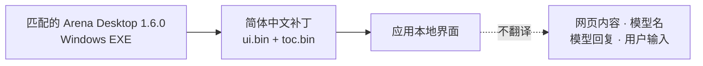
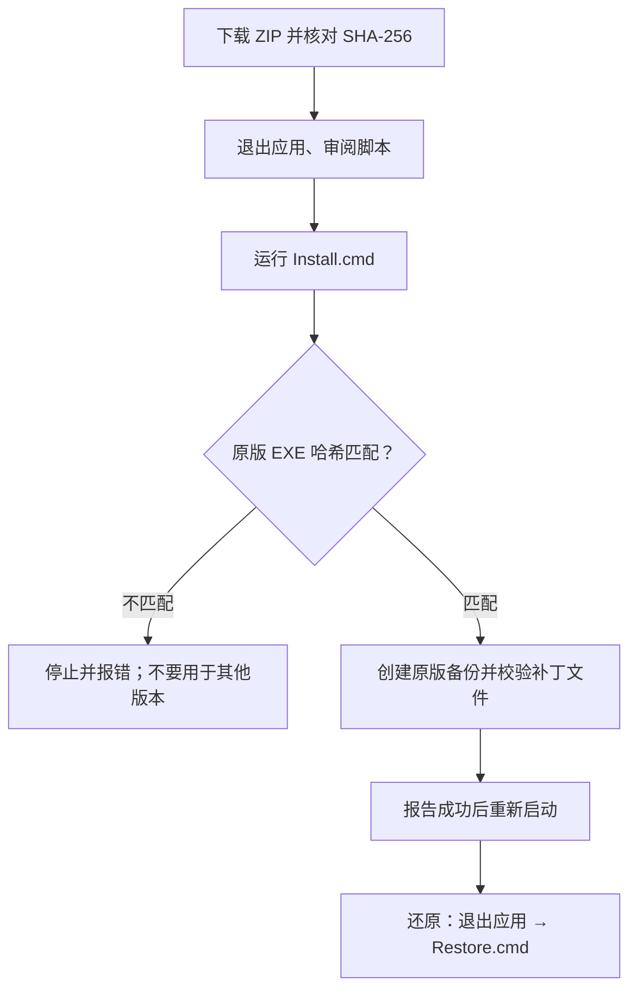

# Arena Desktop 简体中文汉化发布

> 面向与补丁内 SHA-256 匹配的 Windows Arena Desktop 1.6.0 构建。**非官方发布**，不隶属于 Arena AI Inc. 或上游作者。

  

上游 Arena Desktop v1.6.0 原始界面预览（非本补丁运行截图）。图片来源：<a href="https://github.com/PlayzAe/arena.ai-desktop/blob/v1.6.0/docs/screenshots/home.png">上游截图</a>；上游许可见 <a href="https://github.com/PlayzAe/arena.ai-desktop/blob/v1.6.0/LICENSE">LICENSE</a>。

## 补丁速览

| 🧭 版本匹配 | 💾 可还原 | 🌐 翻译范围 |
| --- | --- | --- |
| 仅接受脚本内固定 SHA-256 匹配的原版 EXE；其他构建不适用。 | 首次安装时备份原版；随包提供 `Restore.cmd`。 | 修改应用界面资源；模型名、回复、网页和第三方内容保持原文。 |

上图是补丁范围示意，不是运行结果或兼容性实测。

## 下载与快速步骤

**[打开 GitHub Pre-release 与附件](https://github.com/Denxer6/shine/releases/tag/arena-desktop-1.6.0-zh-cn)** · [完整简体中文说明](README.zh-CN.md)

| 顺序 | 操作 |
| --- | --- |
| 1 | 下载 `Arena-Desktop-1.6.0-zh-CN-Patch.zip`，先对照发布页上的 SHA-256。 |
| 2 | 退出 Arena Desktop；将 ZIP 解压到独立目录并先审阅 `.cmd`、`.ps1`。 |
| 3 | 确认安装版本和原版文件哈希匹配后，运行 `Install.cmd`。 |
| 4 | 仅在脚本报告成功后重启应用。还原时退出应用并运行 `Restore.cmd`。 |

脚本执行和以上安装/还原流程**未在实际 Arena Desktop 上验证**。该补丁会改写应用文件；哈希匹配只确认文件是否与此发布一致，并不能证明补丁安全。请先备份，并阅读 [适用范围、还原、安全与许可证说明](README.zh-CN.md)。

## 发布文件与校验

| 发布文件 | SHA-256 | 内容 |
| --- | --- | --- |
| `Arena-Desktop-1.6.0-zh-CN-Patch.zip` | `8323d00fbf7b6c269e12732b3990b3066a7c9ec1d34a021d0ff715011b439693` | Windows 1.6.0 补丁及安装/还原脚本。 |
| `create-chinese-patch.zip` | `9531495c283edb10c54afe51c727ab5af9706d88047b8ee7664bdbf2fa972d26` | 随附源码/开发归档；其上游修订和构建状态未确认。 |

## 致谢与归属

感谢 [PlayzAe](https://github.com/PlayzAe) 和所有 [Arena Desktop 上游贡献者](https://github.com/PlayzAe/arena.ai-desktop)。项目截图直接链接到上游 `v1.6.0`，没有复制进本仓库。源码 ZIP 内的 MIT LICENSE 原样保留；它不自动适用于上游应用、品牌、补丁资源或本仓库所有内容。再分发前请核对各自许可。

**风险与免责声明：**文件按现状提供，不作兼容性或安全保证；未实测的部分请以 [完整说明](README.zh-CN.md) 为准。使用者自行承担下载、审阅、运行、修改和还原风险，并应遵守适用法律、Arena 服务条款与上游许可。
