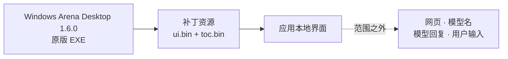
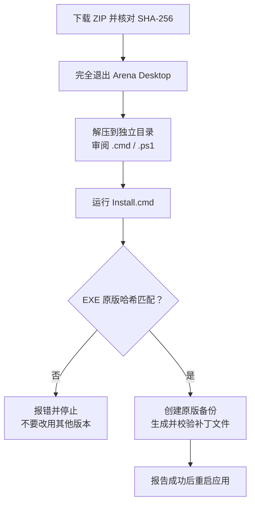
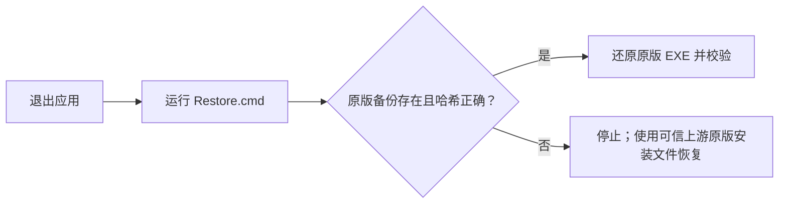

# Arena Desktop 简体中文汉化包

[](https://github.com/Denxer6/shine/releases/tag/arena-desktop-1.6.0-zh-cn)
[](https://github.com/Denxer6/shine/releases/tag/arena-desktop-1.6.0-zh-cn)
[](https://github.com/PlayzAe/arena.ai-desktop)

<p align="center">
  <a href="https://github.com/PlayzAe/arena.ai-desktop/blob/v1.6.0/docs/screenshots/home.png">
    
  </a>
</p>
<p align="center"><sub>上游 Arena Desktop v1.6.0 原始界面预览，并非本补丁运行截图。来源：<a href="https://github.com/PlayzAe/arena.ai-desktop/blob/v1.6.0/docs/screenshots/home.png">上游截图</a>；上游许可：<a href="https://github.com/PlayzAe/arena.ai-desktop/blob/v1.6.0/LICENSE">MIT LICENSE</a>。</sub></p>

本仓库重新发布一份面向特定 **Windows Arena Desktop 1.6.0** 构建的简体中文界面补丁，并保留随附的源码/开发 ZIP。它是非官方社区发布，不隶属于、也未获得 Arena AI Inc. 或上游项目作者认可。Arena Desktop 上游项目：[PlayzAe/arena.ai-desktop](https://github.com/PlayzAe/arena.ai-desktop)；[上游版本发布页](https://github.com/PlayzAe/arena.ai-desktop/releases)。

感谢 **PlayzAe** 及所有上游贡献者开发 Arena Desktop。此仓库仅整理并提供所附汉化资料，不代表上游项目，也不对上游产品或在线服务作保证。

## 三大特点与适用范围图解

| 🧷 版本校验 | 💾 原版备份 | 🌐 翻译范围有限 |
| --- | --- | --- |
| 安装脚本按包内固定 SHA-256 匹配目标 EXE；不匹配即报错。 | 首次安装时在应用目录保存原版备份；提供 `Restore.cmd`。 | 只替换指定的界面资源；Arena 网页、模型名、回复及用户输入不会被翻译。 |



此图为资源作用范围示意，不是汉化效果截图或实机验证结果。

## 版本与适用范围

- **补丁目标：**包内说明明确标注 Arena Desktop 1.6.0。脚本将目标应用文件 SHA-256 与包内固定值比较：原版 `da31a4227c27c459b20cf9233ead267e3680cf606f4ef900e2aef8f45fe68e64`，补丁版 `95dbd637d9a90fbda315ac592b4694d7bad38684b49168495581a7f9fec99c33`。这是脚本声明的匹配值，不是本仓库对某个已安装程序的验证结果。
- **平台：**补丁脚本使用 Windows 命令提示符和 Windows PowerShell。随附上游中文说明描述 Arena Desktop 支持 Windows 10/11，并提及 WebView2 Runtime；请以你所用上游版本的系统要求为准。
- **限定：**仅用于与上述原版哈希完全匹配的 `Arena-Desktop.exe`。其他版本、来源不明或经修改的文件均不在适用范围内。Arena 更新可能覆盖汉化；请勿把补丁后的文件当作原版升级包。
- **翻译范围：**补丁针对应用界面资源；模型名称、模型生成内容及第三方服务返回内容不会因此翻译。具体覆盖范围未经本仓库独立功能测试。
- **源码归档版本：**源码 ZIP 内的 README 描述了 Arena Desktop，但归档未提供可在此确认的上游发布标签或提交号。其根 `package.json` 自报 `0.0.0` 且包名为通用模板名，不能据此推断 Arena Desktop 的产品版本。

## 发布文件

| 文件 | 用途与已知内容 |
| --- | --- |
| [`Arena-Desktop-1.6.0-zh-CN-Patch.zip`](releases/arena-desktop-zh-CN/Arena-Desktop-1.6.0-zh-CN-Patch.zip) | 可供用户手动解压的补丁包，包含 `Install.cmd`、`Restore.cmd`、`Arena-Patch.ps1`、`patch.json` 及二进制资源。 |
| [`create-chinese-patch.zip`](releases/arena-desktop-zh-CN/create-chinese-patch.zip) | 随附的源码/开发归档，原 ZIP 未改动。归档中包含其自身的 `arena-desktop/LICENSE` 和 README，也包含 `.venv`、`.pytest_cache` 项；本仓库未解压这些文件或将其作为独立文件提交。归档内容没有在本仓库重新构建或测试。 |

### SHA-256 校验

以下 SHA-256 是对本仓库中发布的 ZIP 文件计算的；上传/镜像后请先核对哈希，再决定是否使用。

| 文件 | SHA-256 |
| --- | --- |
| `Arena-Desktop-1.6.0-zh-CN-Patch.zip` | `8323d00fbf7b6c269e12732b3990b3066a7c9ec1d34a021d0ff715011b439693` |
| `create-chinese-patch.zip`（源码归档） | `9531495c283edb10c54afe51c727ab5af9706d88047b8ee7664bdbf2fa972d26` |

在 Windows PowerShell 中核对下载文件：

```powershell
Get-FileHash .\Arena-Desktop-1.6.0-zh-CN-Patch.zip -Algorithm SHA256
Get-FileHash .\create-chinese-patch.zip -Algorithm SHA256
```

输出应分别与上表匹配。哈希只能确认文件与此处发布的文件一致，不能证明文件无恶意或补丁本身安全。

## 安装与使用

本仓库没有在真实 Arena Desktop 安装上执行以下步骤；这是根据 ZIP 内 `README-zh-CN.txt` 和脚本内容整理的使用说明。运行前请自行审阅脚本，并确认你信任该发布来源。

1. 退出 Arena Desktop，并先确认目标应用版本与来源；建议保留可信的原版安装包。
2. 下载补丁 ZIP，按上方步骤核对 SHA-256。
3. 将 ZIP 解压到一个独立文件夹，保持 `Install.cmd`、`Restore.cmd`、`Arena-Patch.ps1`、`patch.json`、`ui.bin`、`toc.bin` 在同一目录结构内；不要只复制单个脚本。
4. 双击 `Install.cmd`。脚本默认查找 `%LOCALAPPDATA%\Programs\Arena Desktop\Arena-Desktop.exe`；若未找到，会提示输入 `Arena-Desktop.exe` 的完整路径。包内说明也称可将目标 EXE 拖到 `Install.cmd` 上指定。
5. 只有在脚本报告安装成功后，才重新启动应用。首次安装时脚本会在应用目录创建 `Arena-Desktop.exe.zh-cn-original.bak` 备份。

脚本声明会在改写前校验原版 EXE 的 SHA-256，并校验生成的补丁文件哈希；不匹配时报告错误且不应继续替换。此处仅检查了脚本文本，没有实际执行或独立审计其运行行为。



## 还原

退出应用后，在补丁文件夹中双击 `Restore.cmd`。如果安装时指定了自定义 EXE 路径，还原时也需选择对应的 `Arena-Desktop.exe`（包内说明提及可将该文件拖到 `Restore.cmd` 上）。脚本需要同目录的原版备份文件，并会校验备份哈希。

如果备份缺失、校验失败或还原报错，不要尝试用其他版本的文件拼接或覆盖；从可信上游来源取得与适用版本匹配的原版安装文件，按上游说明恢复/重新安装。还原前同样应完全退出应用。



## 安全、系统要求与已知限制

| 项目 | 要求 / 说明 |
| --- | --- |
| 操作系统 | 随附上游说明描述 Windows 10/11；未在本仓库设备上实测。 |
| 应用版本 | Windows Arena Desktop 1.6.0，且 EXE 必须与补丁内记录的原版 SHA-256 完全匹配。 |
| 运行环境 | `Install.cmd` / `Restore.cmd` 调用 Windows 命令提示符与 Windows PowerShell；目标目录需可读写。 |
| 上游组件 | 随附上游 README 提及 WebView2 Runtime；请按上游版本说明核实系统需求。 |

- 这是会替换本机应用 EXE 内容的二进制补丁，不是只读语言包。修改应用文件有造成程序无法启动、更新冲突或触发安全软件告警的风险。
- `Install.cmd`/`Restore.cmd` 会调用 Windows PowerShell，并带有 `-ExecutionPolicy Bypass` 参数。运行前应审阅 ZIP 中的 `.cmd` 与 `.ps1` 文件；不要因为哈希匹配就假定脚本安全，也不要在不理解风险时运行。
- 确保应用已退出，且当前用户对应用安装目录具有必要的读写权限。若系统提示需要更高权限，请先核实文件来源和操作原因，不要盲目提权。
- 上游随附 README 提到 Windows 10/11 和 WebView2 Runtime 要求；此补丁仓库没有实际确认目标设备的系统组件或兼容性。
- Arena Desktop 更新可能恢复或替换应用文件；升级后不要假设补丁仍适用。升级后必须按新版本单独确认兼容性。
- 仅覆盖有限的本地 UI 资源；不翻译 Arena 网页、模型名、模型回答、用户输入、路径、文件名、代码或第三方服务内容。
- 上游服务的账号、服务条款、限额及人工验证要求仍然适用。本补丁不会也不应绕过这些限制。
- 本次只验证了 ZIP 可读取、条目可列举及 CRC 检查未报告错误，并记录 SHA-256。未安装/运行补丁、未修改本机 Arena 应用、未验证安装或还原结果、未在目标 Windows 设备上做兼容性测试，也未从源码构建或运行测试。

## 许可证与归属

当前仓库原先没有单独的许可证文件，因此**没有在仓库根目录新增一个笼统许可证**。源码 ZIP 内含一个名为 `arena-desktop/LICENSE` 的 MIT License 文件，文本标注 `Copyright (c) 2026 Arena CLI Contributors`；它随源码归档原样保留。该文件的存在不构成对其适用范围的独立法律判断，也不能推定其涵盖上游应用、品牌、第三方内容、补丁二进制资源或此仓库中的所有材料。

Arena Desktop 名称、相关商标和上游项目内容仍归各自权利人所有。请在复制、修改或再分发归档及补丁前，核对归档中的许可证、上游项目许可证和相关权利人的分发条款；本仓库不替任何材料授予超出其原有许可的权利。

## 目录结构

```text
.
├── README.md
├── README.zh-CN.md
└── releases/
    └── arena-desktop-zh-CN/
        ├── Arena-Desktop-1.6.0-zh-CN-Patch.zip
        └── create-chinese-patch.zip
```

## 贡献与反馈

欢迎通过本仓库的 [Issues](https://github.com/Denxer6/shine/issues) 报告文档错误、哈希不匹配或可复现的问题。请勿在公开 issue 中贴出账号 Cookie、令牌、个人文件、日志中的敏感信息或其他凭据。翻译、补丁逻辑和上游应用本身的问题也可分别向[上游项目](https://github.com/PlayzAe/arena.ai-desktop/issues)反馈。

提交问题时请说明 Windows 版本、Arena Desktop 版本、使用的 ZIP 文件名以及复现步骤；不要为了收集信息而运行尚未审阅的补丁。此仓库不作持续维护、响应时限或未来版本兼容承诺。

## 风险与免责声明

文件按现状提供，不作任何明示或默示保证。使用者自行承担下载、审阅、运行、安装、还原及再分发风险；使用前请备份重要数据，并遵守适用法律、Arena 服务条款和上游许可。维护者不对因使用、无法使用或修改应用文件造成的损失承担超出适用法律允许范围的责任。
